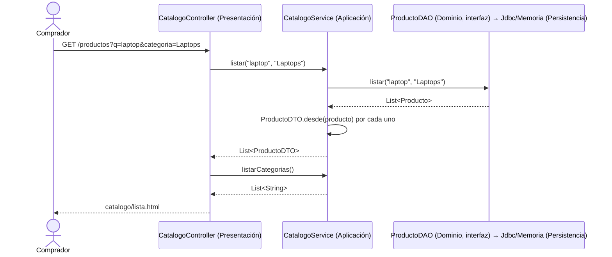

# Spec 01 · Catálogo — Diseño

## Recorrido por capas



## Dominio · `Producto` (completar)

```java
/** Dominio · producto del catálogo con sus reglas de disponibilidad. */
public class Producto {
    private final Long id; private final String sku; private final String nombre;
    private final String descripcion; private final String categoria;
    private final BigDecimal precio; private int stock;

    // Constructor: valida nombre no vacío, precio > 0 (escala 2, HALF_UP), stock >= 0;
    // si no, IllegalArgumentException (es un error de programación/datos, no del comprador).

    public boolean estaAgotado()                 // RN-04: stock == 0
    public boolean hayStockPara(int cantidad)    // RN-03: cantidad <= stock
    public int maximoComprable()                 // min(10, stock)  — RN-02 + RN-03
    // getters; sin setters públicos
}
```

`ProductoNoEncontradoException(Long id)` en `dominio.excepcion`, código `PRODUCTO_NO_ENCONTRADO`, mensaje "El producto solicitado no existe".

## Aplicación · `CatalogoService`

```java
/** Aplicación · casos de uso de consulta del catálogo. */
@Service
public class CatalogoService {
    CatalogoService(ProductoDAO productoDAO)

    public List<ProductoDTO> listar(String texto, String categoria)   // normaliza: trim, vacío → null
    public ProductoDTO obtener(Long id)                               // lanza ProductoNoEncontradoException
    public List<String> listarCategorias()
}
```

Sin `@Transactional` (solo lectura; si se agrega, `readOnly = true`).

## Aplicación · `ProductoDTO`

```java
public record ProductoDTO(
    Long id, String sku, String nombre, String descripcion, String categoria,
    BigDecimal precio, int stock,
    boolean agotado,            // de Producto.estaAgotado()
    int maximoComprable,        // de Producto.maximoComprable()
    String disponibilidad       // "Agotado" | "¡Últimas n unidades!" | "Disponible"
) {
    public static ProductoDTO desde(Producto p) { ... }
}
```

El umbral "últimas unidades" (≤ 3) es **texto de presentación de una regla**, por eso se arma en el DTO (aplicación) y no en la plantilla.

## Persistencia

| Método | `JdbcProductoDAO` (SQL) | `MemoriaProductoDAO` |
|---|---|---|
| `listar(texto, categoria)` | `SELECT … FROM producto` + `WHERE` armado en Java solo con los filtros presentes: `(LOWER(nombre) LIKE :patron OR LOWER(descripcion) LIKE :patron)` y/o `categoria = :categoria`; siempre `ORDER BY nombre`. Parámetros con nombre, nunca concatenando el texto del usuario (evita inyección SQL) | `stream().filter(...).sorted(comparing(nombre))` |
| `buscarPorId(id)` | `SELECT … WHERE id = :id` | `Optional.ofNullable(mapa.get(id))` |
| `listarCategorias()` | `SELECT DISTINCT categoria FROM producto ORDER BY categoria` | `map(categoria).distinct().sorted()` |

Mismo resultado con ambos perfiles (BASE-4.3). Los DAO en memoria devuelven **copias** de los productos para que nadie modifique el mapa por accidente.

## Presentación · `CatalogoController`

| Ruta | Parámetros | Modelo de la vista | Vista |
|---|---|---|---|
| `GET /productos` | `q` (opcional), `categoria` (opcional) | `productos`, `categorias`, `q`, `categoriaActiva` | `catalogo/lista` |
| `GET /productos/{id}` | `id` | `producto` | `catalogo/detalle` |

### Plantillas

- `catalogo/lista.html`: formulario de búsqueda (`GET`), barra de categorías como enlaces, tarjetas de producto (nombre → enlace al detalle, categoría, precio, disponibilidad, botón "Agregar" con cantidad 1 si no está agotado). Mensaje de "sin resultados" (CAT-2.2).
- `catalogo/detalle.html`: datos completos y formulario `POST /carrito/items` con `productoId` y `cantidad` (`<input type="number" min="1" th:max="${producto.maximoComprable}">`).
- Formato de moneda: utilitario Thymeleaf `#numbers.formatDecimal(precio, 1, 'COMMA', 2, 'POINT')` precedido de `S/ `.

## Pruebas

| Prueba | Tipo | Criterios |
|---|---|---|
| `ProductoTest` | Unitaria, dominio puro | RN-04, `hayStockPara`, `maximoComprable`, validaciones del constructor |
| `CatalogoServiceTest` | Unitaria con `MemoriaProductoDAO` (sin Spring) | CAT-1.1, CAT-2.1, CAT-2.3, CAT-3.2, CAT-3.3, CAT-4.3, CAT-5.2 |
| `JdbcProductoDAOTest` | `@JdbcTest` | Filtros por texto y categoría en SQL, orden, categorías distintas |
| `CatalogoControllerTest` | `@WebMvcTest` con `CatalogoService` simulado | Vista y atributos del modelo, 404 en detalle inexistente |
