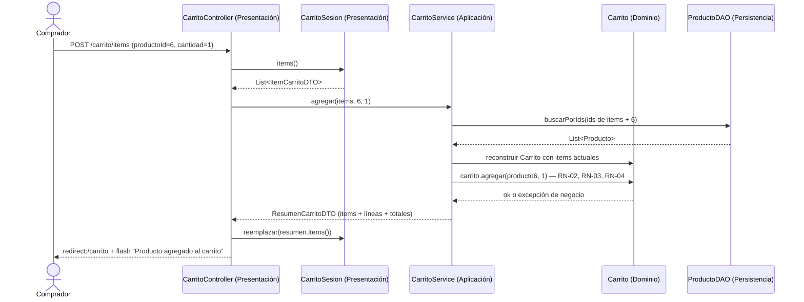

# Spec 02 · Carrito — Diseño

## Dónde vive cada cosa

| Qué | Dónde | Por qué |
|---|---|---|
| Qué productos y cuántas unidades eligió el comprador (`productoId → cantidad`) | `presentacion.sesion.CarritoSesion` (`@SessionScope`) | Es **estado de la interfaz** de un usuario concreto |
| Reglas: 1–10 unidades, no superar stock, agotado, importe, descuento, IGV | `dominio.modelo.Carrito`, `LineaCarrito`, `Totales` | Son **reglas de negocio** (RN-02 a RN-06) |
| Reconstruir el carrito con datos actuales, aplicar la operación y devolver el resumen | `aplicacion.CarritoService` (sin estado) | **Coordinación** del caso de uso |
| Leer precios y stock actuales | `ProductoDAO.buscarPorIds` | **Acceso a datos** |

La presentación **nunca** calcula importes ni decide si hay stock: solo guarda ids y cantidades, y muestra el `ResumenCarritoDTO` que le devuelve la aplicación.

## Recorrido: agregar al carrito



Si el dominio lanza una excepción, el controlador **no** toca la sesión, y `ManejadorErroresWeb` redirige con el mensaje (CAR-1.7).

## Dominio

```java
/** Dominio · línea del carrito: un producto y su cantidad. */
public class LineaCarrito {
    private final Producto producto; private int cantidad;
    public BigDecimal importe()    // producto.precio × cantidad, escala 2
}

/** Dominio · carrito de compras con sus reglas. No sabe dónde se guarda. */
public class Carrito {
    private final Map<Long, LineaCarrito> lineas = new LinkedHashMap<>();   // conserva el orden de inserción

    public void agregar(Producto p, int cantidad)          // suma a la línea existente; valida el total resultante
    public void cambiarCantidad(Producto p, int cantidad)  // reemplaza; valida
    public void quitar(Long productoId)
    public boolean estaVacio()
    public List<LineaCarrito> lineas()                     // copia inmodificable
    public int totalUnidades()
    public Totales totales()                               // Totales.calcular(Σ importes)

    // Validación común (privada): orden de chequeo →
    //   1) p.estaAgotado()           → ProductoAgotadoException      (RN-04)
    //   2) cantidad < 1 || > 10      → CantidadInvalidaException     (RN-02)
    //   3) !p.hayStockPara(cantidad) → StockInsuficienteException    (RN-03)
}

/** Dominio · totales de una compra (RN-05, RN-06). */
public record Totales(BigDecimal subtotal, BigDecimal descuento, BigDecimal baseImponible,
                      BigDecimal igv, BigDecimal total) {
    public static final BigDecimal TASA_IGV = new BigDecimal("0.18");
    public static final BigDecimal UMBRAL_DESCUENTO = new BigDecimal("500.00");
    public static final BigDecimal TASA_DESCUENTO = new BigDecimal("0.05");

    public static Totales calcular(BigDecimal subtotal) {
        // descuento = subtotal >= UMBRAL ? round(subtotal × TASA_DESCUENTO) : 0.00
        // base      = subtotal − descuento
        // igv       = round(base × TASA_IGV)
        // total     = base + igv
        // round = setScale(2, HALF_UP)
    }
    public BigDecimal faltaParaDescuento()   // max(0, UMBRAL − subtotal)
}
```

### Excepciones nuevas (`dominio.excepcion`)

| Excepción | Código | Mensaje |
|---|---|---|
| `CantidadInvalidaException` | `CANTIDAD_INVALIDA` | "La cantidad por producto debe estar entre 1 y 10" |
| `StockInsuficienteException` | `STOCK_INSUFICIENTE` | "Stock insuficiente para «{nombre}»: disponible {stock}" |
| `ProductoAgotadoException` | `PRODUCTO_AGOTADO` | "«{nombre}» está agotado" |

(Agregar `ProductoAgotadoException.java` al árbol de `estructura.md`.)

### Casos de prueba de `Totales` (deben estar en `TotalesTest`)

| Subtotal | Descuento | Base | IGV | Total |
|---|---|---|---|---|
| 49.90 | 0.00 | 49.90 | 8.98 | 58.88 |
| 499.99 | 0.00 | 499.99 | 90.00 | 589.99 |
| 500.00 | 25.00 | 475.00 | 85.50 | 560.50 |
| 549.00 | 27.45 | 521.55 | 93.88 | 615.43 |
| 600.00 | 30.00 | 570.00 | 102.60 | 672.60 |
| 0.00 | 0.00 | 0.00 | 0.00 | 0.00 |

## Aplicación

```java
public record ItemCarritoDTO(Long productoId, int cantidad) {}

public record LineaResumenDTO(Long productoId, String nombre, BigDecimal precioUnitario, int cantidad,
                              BigDecimal importe, int stockDisponible, boolean stockSuficiente) {}

public record ResumenCarritoDTO(
    List<ItemCarritoDTO> items,          // lo que la presentación guarda en sesión
    List<LineaResumenDTO> lineas,        // lo que la vista muestra
    BigDecimal subtotal, BigDecimal descuento, BigDecimal baseImponible, BigDecimal igv, BigDecimal total,
    BigDecimal faltaParaDescuento, int totalUnidades,
    boolean listoParaComprar             // !vacío && todas las líneas con stock suficiente (CAR-5.1)
) {}

/** Aplicación · operaciones del carrito. Sin estado: recibe los ítems, devuelve el resumen. */
@Service
public class CarritoService {
    CarritoService(ProductoDAO productoDAO)

    public ResumenCarritoDTO resumir(List<ItemCarritoDTO> items)
    public ResumenCarritoDTO agregar(List<ItemCarritoDTO> items, Long productoId, int cantidad)
    public ResumenCarritoDTO cambiarCantidad(List<ItemCarritoDTO> items, Long productoId, int cantidad)
    public ResumenCarritoDTO quitar(List<ItemCarritoDTO> items, Long productoId)
}
```

**Reconstrucción del carrito** (método privado común): busca todos los productos con un solo `buscarPorIds`; descarta en silencio los ids que ya no existen (CAR-5.2); para cada ítem crea la línea **sin** validar stock (para poder mostrar CAR-5.1), y luego aplica la operación pedida, que **sí** valida. `resumir` no valida stock: marca `stockSuficiente = false` en las líneas afectadas.

Para soportar CAR-5.1, `Carrito` necesita un método de paquete o una fábrica que permita cargar líneas existentes sin validar stock (p. ej. `Carrito.reconstruir(Map<Producto, Integer>)`), mientras que `agregar` y `cambiarCantidad` siempre validan.

## Presentación

```java
/** Presentación · estado del carrito en la sesión HTTP del comprador. Solo ids y cantidades. */
@Component @SessionScope
public class CarritoSesion implements Serializable {
    private final Map<Long, Integer> items = new LinkedHashMap<>();
    public List<ItemCarritoDTO> items()
    public void reemplazar(List<ItemCarritoDTO> nuevos)
    public void vaciar()
    public int totalUnidades()
}
```

| Ruta | Acción | Redirección |
|---|---|---|
| `GET /carrito` | `carritoService.resumir(sesion.items())` → vista `carrito/ver` | — |
| `POST /carrito/items` | `agregar` → `sesion.reemplazar` | `/carrito` + flash `exito` |
| `POST /carrito/items/{productoId}/cantidad` | `cambiarCantidad` → `reemplazar` | `/carrito` |
| `POST /carrito/items/{productoId}/eliminar` | `quitar` → `reemplazar` | `/carrito` + flash `exito` |
| `POST /carrito/vaciar` | `sesion.vaciar()` | `/carrito` |

Contador de la cabecera (CAR-2.5): un `@ControllerAdvice` con `@ModelAttribute("unidadesCarrito")` que lee `CarritoSesion.totalUnidades()` (o un método en el mismo `ManejadorErroresWeb` si se prefiere no crear otra clase).

### Plantilla `carrito/ver.html`

Tabla de líneas (con input de cantidad + botón "Actualizar" y botón "Quitar" por fila; fila resaltada si `!stockSuficiente`), bloque de totales, aviso de "te faltan S/ x" (CAR-2.3), botones "Seguir comprando", "Vaciar carrito" y "Continuar compra" (`GET /checkout`, deshabilitado si `!listoParaComprar`).

## Pruebas

| Prueba | Tipo | Criterios |
|---|---|---|
| `TotalesTest` | Dominio puro, parametrizada | Tabla de casos de arriba · RN-05, RN-06 |
| `CarritoTest` | Dominio puro | RN-02, RN-03, RN-04; suma en la misma línea; quitar; carrito vacío |
| `CarritoServiceTest` | Aplicación con `MemoriaProductoDAO` | CAR-1.1 a CAR-1.7, CAR-2.6, CAR-5.1, CAR-5.2 |
| `CarritoControllerTest` | `@WebMvcTest` | Redirecciones, flash, la sesión no cambia si el servicio lanza excepción |
