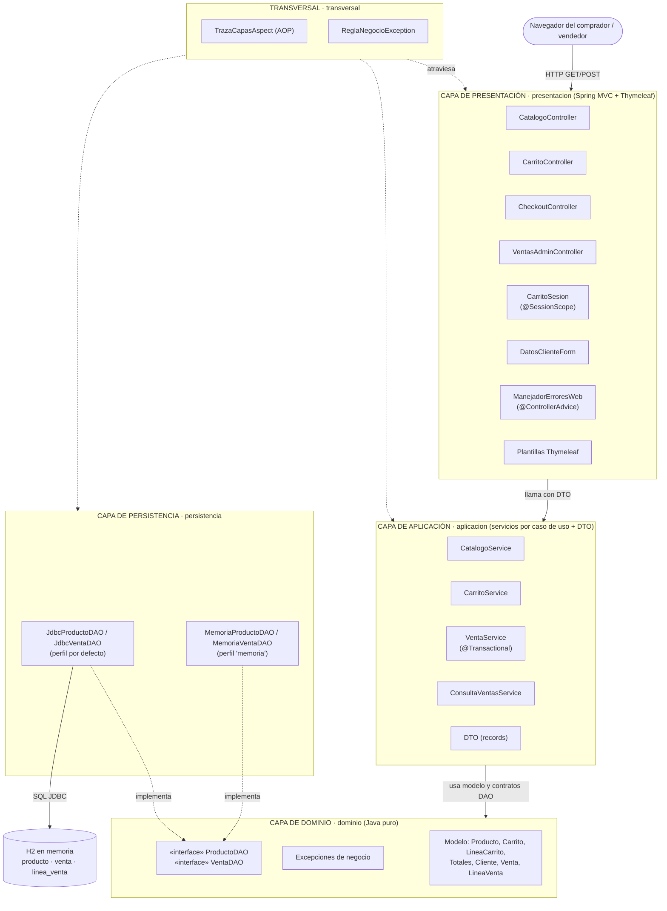
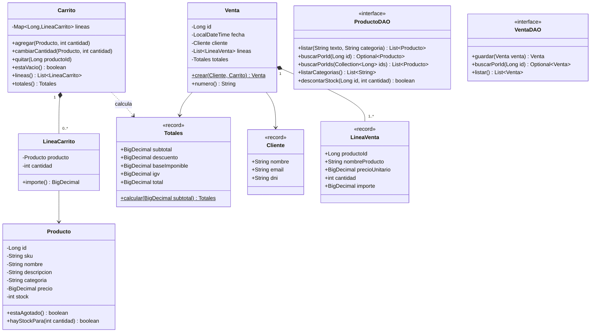
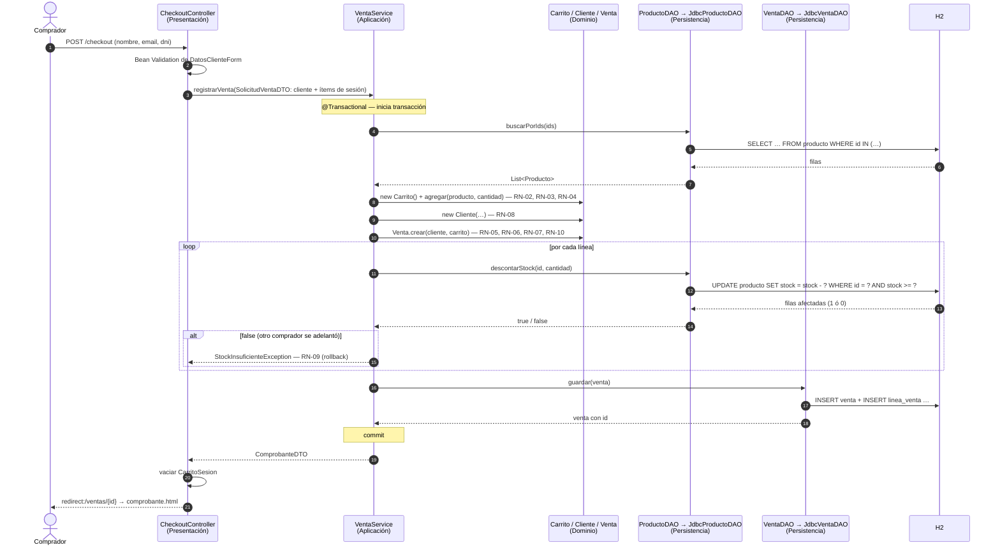
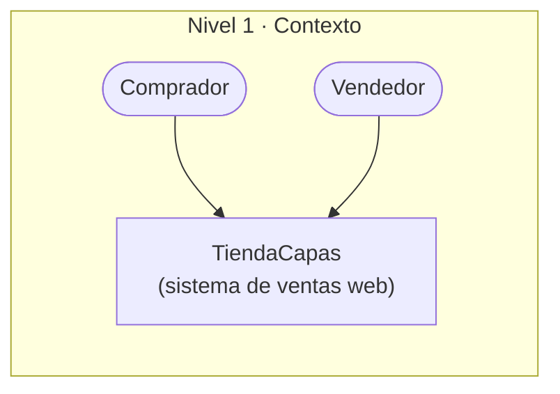
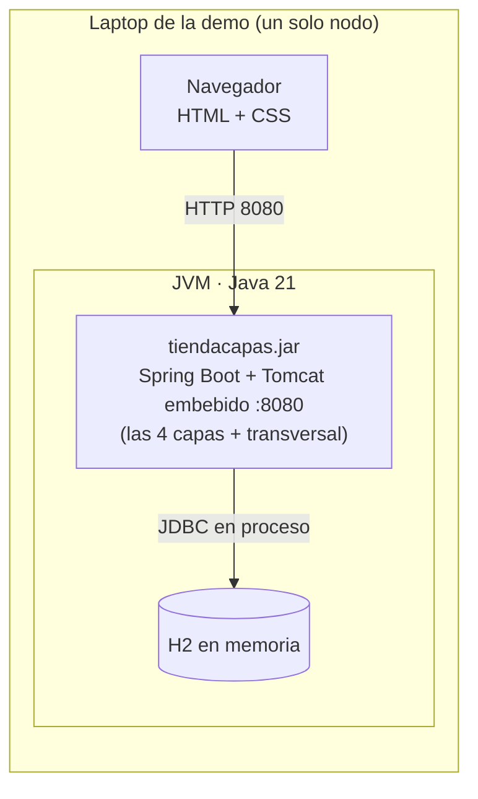

# Arquitectura implementada · TiendaCapas

> Documento de arquitectura de la Parte C. Los diagramas describen **lo que se va a implementar**, paquete por paquete: si el código cambia, este documento se actualiza en el mismo commit (el docente exige que diagramas y demo coincidan).

## 1. Estilo asignado y variante

**Estilo arquitectónico: Arquitectura en Capas**, en su variante **N-capas orientada al dominio**: presentación → aplicación → dominio → infraestructura de persistencia, más una capa de infraestructura **transversal**. Se omite la capa de servicios distribuidos porque el único cliente es el navegador y el sistema es un solo desplegable.

- **Capas cerradas**: presentación solo usa aplicación; aplicación solo usa dominio.
- **Dominio en el centro**: las reglas de negocio no dependen de cómo se muestran ni de cómo se guardan.
- **Inversión de dependencias en la frontera con los datos**: el dominio define las interfaces DAO y la persistencia las implementa.
- Dentro de la capa de presentación se usa el **patrón MVC** de Spring (controlador, modelo de vista, plantilla). MVC **complementa** a las capas; no las reemplaza.

## 2. Metas arquitectónicas (MA)

| Código | Meta |
|---|---|
| **MA01** | Mantener una separación clara de responsabilidades entre presentación, lógica de aplicación, reglas de negocio y acceso a datos, para facilitar el desarrollo en paralelo, las pruebas y el mantenimiento. |
| **MA02** | Permitir **reemplazar la tecnología de persistencia** (o de presentación) sin modificar las demás capas. |
| **MA03** | Garantizar la **integridad de cada venta**: totales correctos y stock coherente, incluso si dos compradores compran a la vez. |
| **MA04** | Hacer **verificable** el cumplimiento del estilo: que una violación de capas se detecte automáticamente, no por revisión manual. |

## 3. Escenarios de atributos de calidad (EC)

| Código | Atributo | Escenario (fuente · estímulo · artefacto · ambiente · respuesta · medida) | Cómo se verifica | Meta |
|---|---|---|---|---|
| **EC01** | Modificabilidad | Un desarrollador (fuente) necesita cambiar el almacenamiento de JDBC+H2 a otro mecanismo (estímulo) en el sistema (artefacto), en desarrollo (ambiente). El cambio se hace agregando una implementación de `ProductoDAO` y `VentaDAO` y activándola por perfil (respuesta), con **0 archivos modificados** fuera de `persistencia` y de la configuración (medida). | Demo: arrancar con `-Dspring-boot.run.profiles=memoria` y repetir la compra. `git diff --stat` de la tarea muestra solo `persistencia/` | MA02 |
| **EC02** | Testabilidad | Un desarrollador (fuente) ejecuta las pruebas de reglas de negocio (estímulo) sobre el dominio y los servicios (artefacto), sin base de datos ni servidor (ambiente). Las pruebas corren sin Spring ni H2 (respuesta): **100 % de las reglas RN-02 a RN-10** tienen al menos una prueba unitaria pura, y la suite de dominio corre en **< 5 s** (medida). | `./mvnw test -Dtest='**/dominio/**/*Test'` | MA01 |
| **EC03** | Conformidad arquitectónica | Un integrante (fuente) agrega por error un `import` de `persistencia` en un controlador (estímulo) en el código (artefacto), al compilar y probar (ambiente). El build falla indicando la regla violada (respuesta) en el **100 %** de las violaciones AR-01 a AR-07 (medida). | `ArquitecturaCapasTest` + demo de "romper y ver fallar" | MA04 |
| **EC04** | Integridad / confiabilidad | Dos compradores (fuente) confirman a la vez la compra de la última unidad de un producto (estímulo) sobre `VentaService` y la tabla `producto` (artefacto), en operación normal (ambiente). Solo una venta se registra; la otra se rechaza con "stock insuficiente" y no deja nada a medias (respuesta). Stock final **= 0, nunca negativo**, y **1** sola venta registrada (medida). | Prueba de integración del DAO (`UPDATE … WHERE stock >= ?`) + prueba del servicio con rollback | MA03 |
| **EC05** | Rendimiento (secundario) | Un comprador (fuente) confirma una compra de hasta 10 líneas (estímulo) en la app local (artefacto), con un solo usuario (ambiente). La venta se registra y se muestra el comprobante (respuesta) en **< 1 s** (medida). Se documenta para mostrar que el costo de atravesar capas es despreciable en este contexto. | Tiempo de respuesta visible en la traza de consola | MA01 |

## 4. Restricciones arquitectónicas (RA)

| Código | Tipo | Restricción |
|---|---|---|
| **RA01** | Académica | El estilo es **Arquitectura en Capas** (asignado por el docente). La evidencia debe ser demostrable en vivo. |
| **RA02** | Tecnología | Backend en **Java** (decisión del grupo), Java 21 LTS. |
| **RA03** | Datos | Persistencia en base de datos **relacional** con transacciones. |
| **RA04** | Operación | La demo debe correr en una laptop, **sin internet ni servicios externos**, con un solo comando. |
| **RA05** | Alcance | Caso acotado: sin login, sin pagos reales, sin CRUD de productos. |

## 5. Vista lógica: las capas y sus componentes

**Lectura del diagrama**: las flechas sólidas son dependencias de uso hacia abajo; las punteadas "implementa" muestran la inversión de dependencias: la persistencia conoce al dominio, el dominio no conoce a la persistencia. En ejecución, Spring inyecta en `VentaService` la implementación de `ProductoDAO` que corresponda al perfil activo.

### Responsabilidades por componente

| Componente | Capa | Responsabilidad | Spec |
|---|---|---|---|
| `CatalogoController` | Presentación | `GET /productos`, `GET /productos/{id}` | 01 |
| `CarritoController` | Presentación | Rutas `/carrito/**`; lee y escribe `CarritoSesion` | 02 |
| `CheckoutController` | Presentación | `GET/POST /checkout`, `GET /ventas/{id}` (comprobante) | 03 |
| `VentasAdminController` | Presentación | `GET /admin/ventas`, `GET /admin/ventas/{id}` | 04 |
| `CarritoSesion` | Presentación | Estado de UI: mapa `productoId → cantidad` en la sesión HTTP | 02 |
| `ManejadorErroresWeb` | Presentación | Convierte `ReglaNegocioException` en mensajes y códigos HTTP | 00 |
| `CatalogoService` | Aplicación | Listar, buscar y obtener productos como `ProductoDTO` | 01 |
| `CarritoService` | Aplicación | Reconstruye un `Carrito` de dominio desde los ítems de sesión, aplica la operación y devuelve `ResumenCarritoDTO` | 02 |
| `VentaService` | Aplicación | Caso de uso "Registrar venta": transacción, revalidación, descuento de stock, guardado | 03 |
| `ConsultaVentasService` | Aplicación | Listar ventas y obtener detalle | 04 |
| `Producto`, `Carrito`, `Totales`, `Cliente`, `Venta`, `LineaVenta` | Dominio | Reglas RN-01 a RN-10 | 01–03 |
| `ProductoDAO`, `VentaDAO` | Dominio | Contratos de acceso a datos | 00 |
| `Jdbc*DAO` | Persistencia | SQL con `JdbcClient`; mapeo filas ↔ dominio | 00–04 |
| `Memoria*DAO` | Persistencia | Mismos contratos con colecciones `ConcurrentHashMap` | 00–04 |
| `TrazaCapasAspect` | Transversal | Imprime en consola la entrada/salida de cada componente indicando su capa | 00 |

## 6. Modelo del dominio

## 7. Recorrido de la funcionalidad de la demo: "Registrar venta"

En consola, `TrazaCapasAspect` imprime el mismo recorrido con sangría por capa (formato en `specs/00-fundaciones-capas/design.md`). Eso es lo que se muestra en el video.

## 8. Vista de implementación (C4 nivel 3, componentes por paquete)

| Paquete | Artefacto | Depende de |
|---|---|---|
| `pe.edu.ulima.tiendacapas.presentacion` | dentro de `tiendacapas.jar` | `aplicacion`, `transversal`, Spring MVC, Thymeleaf |
| `pe.edu.ulima.tiendacapas.aplicacion` | dentro de `tiendacapas.jar` | `dominio`, `transversal`, Spring (`@Service`, `@Transactional`) |
| `pe.edu.ulima.tiendacapas.dominio` | dentro de `tiendacapas.jar` | `transversal.error` (Java puro) |
| `pe.edu.ulima.tiendacapas.persistencia` | dentro de `tiendacapas.jar` | `dominio`, `transversal`, Spring JDBC |
| `pe.edu.ulima.tiendacapas.transversal` | dentro de `tiendacapas.jar` | Spring AOP |

El árbol completo de paquetes y clases está en `specs/steering/estructura.md`.

## 9. Vista de despliegue y contexto (C4 niveles 1 y 2)

**Capas ≠ niveles (tiers)**: las cuatro capas se despliegan **juntas en un único proceso**. La separación es **lógica** (paquetes y reglas de dependencia), no física. Si mañana la base de datos pasara a un servidor PostgreSQL aparte, el sistema empezaría a ser **multi-tier**, y gracias a las capas ese cambio solo tocaría `persistencia` y la configuración.

## 10. Decisiones arquitectónicas (con su porqué)

| ID | Decisión | Alternativa | Por qué | Trade-off aceptado | Responde a |
|---|---|---|---|---|---|
| **D01** | Capas **cerradas** (estrictas) | Capas abiertas (presentación podría leer el dominio o el DAO) | Cada capa solo conoce a la de abajo → cambios localizados y reglas fáciles de verificar | Más DTO y mapeos; algunos métodos de servicio "solo pasan" la llamada | MA01, EC03 |
| **D02** | Interfaces DAO en el **dominio**, implementaciones en persistencia (DIP) | Interfaces DAO en persistencia (aplicación dependería de persistencia) | El negocio no depende del detalle técnico más volátil; permite el perfil `memoria` | La flecha de código "sube" de persistencia a dominio; hay que explicarlo | MA02, EC01 |
| **D03** | Spring **JDBC** con SQL explícito, sin JPA | Spring Data JPA | Dominio sin anotaciones de persistencia; el DAO muestra su SQL y su responsabilidad | Más código de mapeo a mano | MA01, EC02 |
| **D04** | Thymeleaf en servidor, un solo desplegable | SPA + API REST | Se demuestra la separación **lógica** (capas), no la física (multi-tier) | Interfaz menos dinámica | RA01 |
| **D05** | Carrito en **sesión HTTP** (presentación) y servicios **sin estado** | Carrito persistido en BD | El carrito es estado de interfaz; las reglas del carrito igual se ejecutan en el dominio | El carrito se pierde al cerrar la sesión (aceptable en el alcance) | MA01, RA05 |
| **D06** | Excepción base `ReglaNegocioException` en **transversal** | Excepciones del dominio visibles en presentación | La presentación maneja errores sin conocer el dominio (respeta AR-03) | Un paquete transversal más | MA01 |
| **D07** | **ArchUnit** como prueba de arquitectura (fitness function) | Revisión manual | La regla del estilo se vuelve verificable y falla el build | Dependencia de prueba adicional | MA04, EC03 |
| **D08** | Descuento de stock con `UPDATE … WHERE stock >= ?` dentro de `@Transactional` | Leer stock, comparar en Java y luego actualizar | Evita la condición de carrera sin bloqueos explícitos | La regla de "no negativo" queda reforzada también en SQL (además del dominio) | MA03, EC04 |
| **D09** | Traza por capa con **AOP** | `println` en cada método | Es un servicio transversal: se aplica sin tocar el código de las capas | Magia de proxies que hay que explicar | MA01 |

## 11. Por qué esto es Arquitectura en Capas (argumento para el video)

No basta con que existan paquetes llamados `presentacion` o `dominio`. La implementación corresponde al estilo porque cumple sus **restricciones**, y cada una se puede demostrar en vivo:

| Restricción del estilo | Evidencia en el sistema | Cómo se muestra en vivo |
|---|---|---|
| Cada capa tiene **un solo tipo de responsabilidad** | Los controladores no calculan totales; los servicios no tienen SQL; los DAO no validan stock; el dominio no sabe de HTTP ni de SQL | Abrir `CheckoutController`, `VentaService`, `Venta`, `JdbcProductoDAO` y comparar |
| Una capa **solo usa a la inmediatamente inferior** | `ArquitecturaCapasTest` (AR-01 a AR-07) | Correr la prueba en verde; agregar un `import` prohibido y verla fallar |
| Las capas inferiores **no conocen** a las superiores | `dominio` sin Spring ni JDBC (AR-05) | Mostrar los imports de `Venta.java` |
| Una capa se puede **reemplazar** sin afectar a las demás | Perfil `memoria` | Reiniciar con el perfil y repetir la compra |
| Una petición **atraviesa las capas en orden** | `TrazaCapasAspect` | Confirmar una compra y leer la traza en la consola |
| Las capas se **prueban por separado** | Pruebas de dominio sin BD; servicios con DAO en memoria; controladores con servicios simulados | Correr `./mvnw test` y señalar cada grupo |

### Relación con otros estilos y patrones (para no confundirse en la defensa)

| Comparado con | Diferencia concreta en este proyecto |
|---|---|
| **MVC** | Compiten en nombre pero no en nivel: MVC organiza **solo la capa de presentación** (controlador + plantilla + modelo de vista). Las capas organizan **todo el sistema**. Se **complementan**. |
| **Multi-tier** | Capas = separación lógica en un solo proceso (este proyecto). Multi-tier = esas capas en nodos distintos. Se complementan: este diseño puede volverse multi-tier sin rediseñarse. |
| **Microservicios** | Aquí hay **un solo desplegable** dividido horizontalmente por responsabilidad técnica; microservicios divide **verticalmente** por capacidad de negocio, cada uno con su BD y despliegue. Compiten como forma de organizar el sistema. |
| **EDA** | Aquí la comunicación entre capas es **síncrona** (llamada a método); en EDA sería por eventos asíncronos. |
| **DDD** | Es un **enfoque**, no un estilo: aquí se usa una idea de DDD (dominio en el centro, sin dependencias técnicas), pero no hay contextos delimitados ni agregados formales. |
