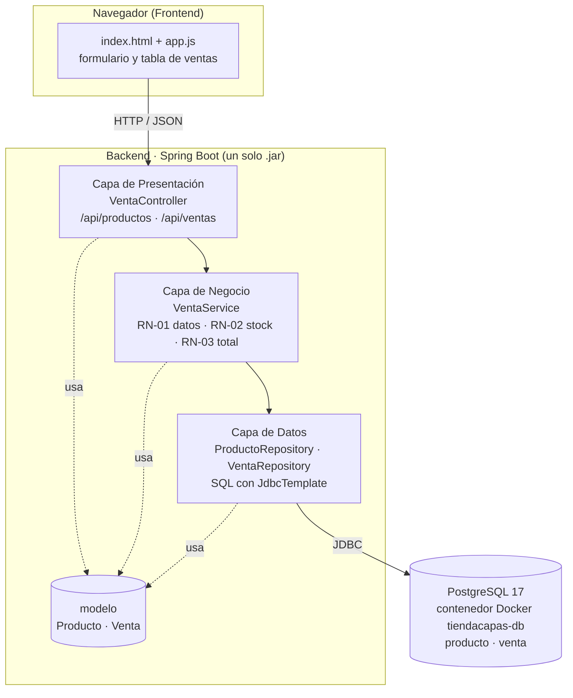
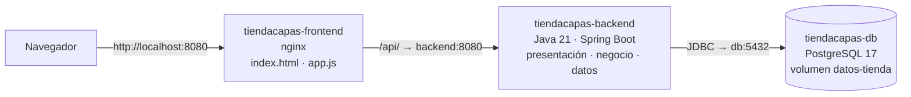
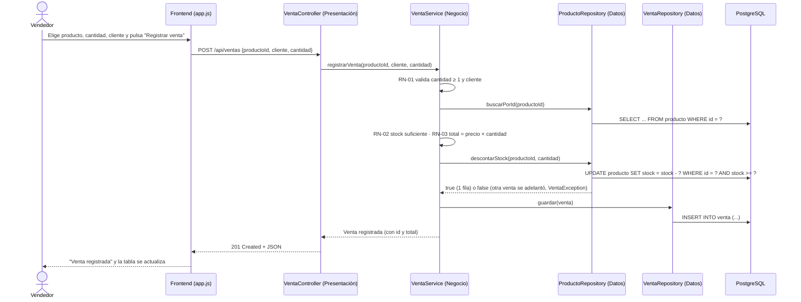

# Arquitectura implementada · TiendaCapas

> Describe **lo que se implementa**, clase por clase. Si el código cambia, este documento se actualiza en el mismo commit (el docente exige que diagramas y demo coincidan).

## 1. Estilo y variante

**Arquitectura en Capas**, variante de **3 capas cerradas** + base de datos:

- **Presentación**: frontend (HTML/JS) + controlador REST.
- **Negocio**: reglas y cálculo.
- **Datos**: acceso a la base de datos con SQL.

Cada capa ofrece servicios a la de arriba y solo usa a la de abajo. Todo el backend es **un solo desplegable** (un `.jar`); la separación es **lógica**.

## 2. Diagrama de capas (lo que se muestra en la PPT)

| Componente | Tecnología | Responsabilidad |
|---|---|---|
| `index.html`, `app.js` | HTML, CSS, JavaScript `fetch` | Formulario de venta y tabla de ventas |
| `VentaController` | Spring Web (`@RestController`) | Recibir JSON, llamar al servicio, devolver respuesta o error 400 |
| `VentaService` | Spring (`@Service`, `@Transactional`) | Validar RN-01/RN-02, calcular total (RN-03), descontar stock y guardar |
| `ProductoRepository`, `VentaRepository` | Spring JDBC (`JdbcTemplate`) | `SELECT`, `INSERT`, `UPDATE` |
| PostgreSQL | Contenedor `tiendacapas-db` (`base-de-datos/Dockerfile`) | Tablas `producto` y `venta`; datos persistentes en un volumen |

### Despliegue en contenedores (vista física)

Las mismas reglas de capas se ven en la red: el navegador solo conoce a nginx; el backend no se publica en la PC; solo la capa de datos del backend abre conexiones a PostgreSQL.

## 3. Recorrido de "Registrar venta" (secuencia)

Si una regla falla, `VentaService` lanza `VentaException`; el controlador la convierte en **400** con `{"error": "mensaje"}` y el frontend lo muestra. Como el método es `@Transactional`, si algo falla no se descuenta stock ni se guarda nada.

## 4. Por qué es Arquitectura en Capas (no basta el nombre)

| Característica del estilo | Evidencia en el código |
|---|---|
| Separación por responsabilidad | El controlador no tiene reglas de negocio; el servicio no tiene SQL ni HTTP; el repositorio no tiene reglas. |
| Capas cerradas, dependencia hacia abajo | `VentaController` importa solo de la capa de negocio (`VentaService`, `VentaException`) y de `modelo`, nunca un repositorio; `VentaService` importa los repositorios y `modelo`, nunca nada de `presentacion`; los repositorios importan solo `JdbcTemplate` y `modelo` (mostrar los `import` en el video; detalle en `estructura.md`). |
| Cada capa ofrece una interfaz a la superior | Controlador → endpoints HTTP; servicio → `registrarVenta(...)`; repositorio → `buscarPorId`, `descontarStock`, `guardar`. |
| Cambios localizados | Se pasó de H2 a PostgreSQL cambiando solo `application.properties`, el `pom.xml` y `schema.sql`: **ni una línea** de presentación, negocio o datos (Java) cambió. Cambiar el frontend no toca negocio ni datos. |
| Recorrido visible | La consola muestra `[PRESENTACIÓN] → [NEGOCIO] → [DATOS]` en cada venta. |

## 5. Trade-offs (para conclusiones)

- **A favor**: fácil de entender, de repartir entre integrantes y de probar por capa; los cambios quedan localizados.
- **En contra**: algunas llamadas solo "pasan" por una capa (p. ej. listar ventas); todo se despliega junto, así que no se puede escalar una capa por separado (eso ya sería multi-tier o microservicios).
- **Frente a MVC**: MVC organiza la interfaz; las capas organizan todo el sistema. Se complementan.
- **Frente a Multi-Tier**: el estilo que se demuestra es la separación **lógica** en capas cerradas (presentación → negocio → datos), visible en los paquetes y sus `import`. Que cada pieza corra en su contenedor es la vista **física** (despliegue): las capas se pueden desplegar juntas o separadas sin cambiar el código. Multi-Tier pone el foco en esa separación física (escalar y desplegar cada nivel por su cuenta); aquí se usa solo para facilitar la ejecución.
